# Transformasi Intensitas dan Filtering Spasial

## Berdasarkan Bab 3: Intensity Transformations and Spatial Filtering

# 📚 Daftar Isi Lengkap

## **📖 Bagian I: Konsep Fundamental Transformasi Intensitas dan Filtering Spasial**

### **1. [Pendahuluan](#1-pendahuluan)**
- 1.1 [Transformasi Intensitas (Point Processing)](#11-transformasi-intensitas-point-processing)
- 1.2 [Filtering Spasial (Neighborhood Processing)](#12-filtering-spasial-neighborhood-processing)

### **2. [Transformasi Intensitas Dasar](#2-transformasi-intensitas-dasar)**
- 2.1 [Fungsi Transformasi](#21-fungsi-transformasi)
  - 2.1.1 Notasi Matematis Transformasi
  - 2.1.2 Domain dan Range Transformasi
- 2.2 [Linear Transformation](#22-linear-transformation)
  - 2.2.1 [Identity Transformation](#221-identity-transformation)
  - 2.2.2 [Negative Transformation](#222-negative-transformation)
  - 2.2.3 [Contrast Stretching](#223-contrast-stretching)
- 2.3 [Logarithmic Transformation](#23-logarithmic-transformation)
  - 2.3.1 Formula dan Konstanta Scaling
  - 2.3.2 Aplikasi pada Citra Dynamic Range Tinggi
- 2.4 [Power-Law (Gamma) Transformation](#24-power-law-gamma-transformation)
  - 2.4.1 Variasi Nilai Gamma
  - 2.4.2 Gamma Correction pada Display Devices
- 2.5 [Piecewise-Linear Transformation](#25-piecewise-linear-transformation)
  - 2.5.1 Contrast Stretching
  - 2.5.2 Thresholding
  - 2.5.3 Gray-Level Slicing

### **3. [Histogram Processing](#3-histogram-processing)**
- 3.1 [Histogram Definition](#31-histogram-definition)
- 3.2 [Normalized Histogram](#32-normalized-histogram)
- 3.3 [Histogram Equalization](#33-histogram-equalization)
  - 3.3.1 Algoritma dan Implementasi
  - 3.3.2 Properties dan Karakteristik
- 3.4 [Histogram Matching (Specification)](#34-histogram-matching-specification)
  - 3.4.1 Proses Mapping
  - 3.4.2 Aplikasi Praktis
- 3.5 [Local Histogram Processing](#35-local-histogram-processing)

## **📖 Bagian II: Teknik Filtering Spasial**

### **4. [Spatial Filtering](#4-spatial-filtering)**
- 4.1 [Fundamental Concepts](#41-fundamental-concepts)
  - 4.1.1 Filter Mask/Kernel
  - 4.1.2 Anchor Point dan Neighborhood
- 4.2 [Convolution Operation](#42-convolution-operation)
  - 4.2.1 Matematis Formula
  - 4.2.2 Boundary Handling
- 4.3 [Smoothing Linear Filters](#43-smoothing-linear-filters)
  - 4.3.1 [Box Filter (Mean Filter)](#431-box-filter-mean-filter)
  - 4.3.2 [Weighted Average Filter](#432-weighted-average-filter)
  - 4.3.3 [Gaussian Filter](#433-gaussian-filter)
- 4.4 [Sharpening Linear Filters](#44-sharpening-linear-filters)
  - 4.4.1 [Laplacian Filter](#441-laplacian-filter)
  - 4.4.2 [Unsharp Masking](#442-unsharp-masking)
  - 4.4.3 [High-Boost Filtering](#443-high-boost-filtering)

### **5. [Order-Statistics Filters](#5-order-statistics-filters)**
- 5.1 [Median Filter](#51-median-filter)
- 5.2 [Variations](#52-variations)
  - 5.2.1 [Max Filter](#521-max-filter)
  - 5.2.2 [Min Filter](#522-min-filter)
  - 5.2.3 [Midpoint Filter](#523-midpoint-filter)
  - 5.2.4 [Alpha-Trimmed Mean Filter](#524-alpha-trimmed-mean-filter)

### **6. [Gradient-Based Filters](#6-gradient-based-filters)**
- 6.1 [First-Order Derivatives](#61-first-order-derivatives)
  - 6.1.1 [Sobel Operator](#611-sobel-operator)
  - 6.1.2 [Prewitt Operator](#612-prewitt-operator)
  - 6.1.3 [Roberts Cross-Gradient](#613-roberts-cross-gradient)
- 6.2 [Second-Order Derivatives](#62-second-order-derivatives)
  - 6.2.1 [Laplacian of Gaussian (LoG)](#621-laplacian-of-gaussian-log)

### **7. [Adaptive Filters](#7-adaptive-filters)**
- 7.1 [Adaptive Median Filter](#71-adaptive-median-filter)
- 7.2 [Adaptive Local Noise Reduction](#72-adaptive-local-noise-reduction)

## **📖 Bagian III: Aplikasi Lanjutan**

### **8. [Transformations for Color Images](#8-transformations-for-color-images)**
- 8.1 [Color Space Considerations](#81-color-space-considerations)
  - 8.1.1 RGB Space
  - 8.1.2 HSI/HSV Space
  - 8.1.3 YCbCr Space
- 8.2 [Color Enhancement Techniques](#82-color-enhancement-techniques)

### **9. [Implementation Considerations](#9-implementation-considerations)**
- 9.1 [Computational Complexity](#91-computational-complexity)
- 9.2 [Boundary Handling](#92-boundary-handling)
- 9.3 [Hardware Acceleration](#93-hardware-acceleration)

### **10. [Applications](#10-applications)**
- 10.1 [Medical Imaging](#101-medical-imaging)
- 10.2 [Remote Sensing](#102-remote-sensing)
- 10.3 [Computer Vision](#103-computer-vision)
- 10.4 [Photography](#104-photography)

### **11. [Advanced Topics](#11-advanced-topics)**
- 11.1 [Multi-scale Filtering](#111-multi-scale-filtering)
- 11.2 [Anisotropic Filtering](#112-anisotropic-filtering)
- 11.3 [Deep Learning Approaches](#113-deep-learning-approaches)

### **12. [Performance Evaluation](#12-performance-evaluation)**
- 12.1 [Quality Metrics](#121-quality-metrics)
  - 12.1.1 Mean Squared Error (MSE)
  - 12.1.2 Peak Signal-to-Noise Ratio (PSNR)
  - 12.1.3 Structural Similarity Index (SSIM)
- 12.2 [Visual Assessment](#122-visual-assessment)

---

## **🎯 Bagian IV: Latihan Praktis dan Studi Kasus**

### **📝 Latihan Dasar (Soal 3.1 - 3.3)**
- [Soal 3.1: Transformasi Intensitas Dasar](#soal-31-transformasi-intensitas-dasar)
- [Soal 3.2: Histogram Processing](#soal-32-histogram-processing)
- [Soal 3.3: Spatial Filtering untuk Noise Reduction](#soal-33-spatial-filtering-untuk-noise-reduction)

### **💻 Latihan Implementasi (Soal 3.4 - 3.6)**
- [Soal 3.4: Transformasi Intensitas dengan Matriks Konkret](#soal-34-transformasi-intensitas-dengan-matriks-konkret)
- [Soal 3.5: Histogram Equalization dengan Data Numerik](#soal-35-histogram-equalization-dengan-data-numerik)
- [Soal 3.6: Spatial Filtering dengan Operasi Konvolusi](#soal-36-spatial-filtering-dengan-operasi-konvolusi)

### **🚀 Latihan Lanjutan (Soal 3.7 - 3.10)**
- [Soal 3.7: Piecewise-Linear Transformations](#soal-37-piecewise-linear-transformations)
- [Soal 3.8: Adaptive Histogram Equalization](#soal-38-adaptive-histogram-equalization)
- [Soal 3.9: Pemilihan Filter untuk Aplikasi Spesifik](#soal-39-pemilihan-filter-untuk-aplikasi-spesifik)
- [Soal 3.10: Evaluasi Kinerja Filter](#soal-310-evaluasi-kinerja-filter)

---

## **🔬 Bagian V: Soal Struktural Terperinci**

### **📊 Q1: Histogram Equalization pada Citra 3-bit**
- [Deskripsi Soal](#q1-deskripsi-soal)
- [Data Input dan Analisis Awal](#q1-data-input-dan-analisis-awal)
- [Langkah 1: Visualisasi Histogram](#q1-langkah-1-visualisasi-histogram)
- [Langkah 2: Perhitungan PMF](#q1-langkah-2-perhitungan-pmf)
- [Langkah 3: Perhitungan CDF](#q1-langkah-3-perhitungan-cdf)
- [Langkah 4: Transformasi Equalization](#q1-langkah-4-transformasi-equalization)
- [Langkah 5: Visualisasi Histogram Equalized](#q1-langkah-5-visualisasi-histogram-equalized)
- [Kesimpulan dan Analisis Hasil](#q1-kesimpulan-dan-analisis-hasil)

### **🔧 Q2: Operasi Konvolusi dan Korelasi**
- [Deskripsi Soal](#q2-deskripsi-soal)
- [Analisis Matriks Input](#q2-analisis-matriks-input)
- [Case Q2a: Convolution w ★ fₐ](#case-q2a-convolution-w--fa)
  - [Perhitungan Detil Konvolusi](#perhitungan-detil-konvolusi)
  - [Interpretasi Hasil Konvolusi](#interpretasi-hasil-konvolusi)
- [Case Q2a: Correlation w ☆ fₐ](#case-q2a-correlation-w--fa)
  - [Perhitungan Detil Korelasi](#perhitungan-detil-korelasi)
  - [Interpretasi Hasil Korelasi](#interpretasi-hasil-korelasi)
- [Case Q2b: Convolution w ★ f₆](#case-q2b-convolution-w--fb)
- [Case Q2b: Correlation w ☆ f₆](#case-q2b-correlation-w--fb)
- [Perbandingan Komprehensif dan Kesimpulan](#perbandingan-komprehensif-dan-kesimpulan)

## **🎯 Kesimpulan**

## 1. Pendahuluan

### Transformasi Intensitas
Transformasi intensitas adalah operasi point processing di mana setiap piksel dalam citra input dipetakan ke piksel yang sesuai dalam citra output. Nilai output hanya bergantung pada nilai input piksel tersebut, tidak pada tetangganya.

### Filtering Spasial
Filtering spasial adalah operasi neighborhood processing di mana nilai output piksel bergantung pada nilai piksel input dan tetangganya dalam suatu region.

## 2. Transformasi Intensitas Dasar

### Fungsi Transformasi
Transformasi intensitas dinyatakan sebagai:
```
s = T(r)
```
di mana:
- **r**: Intensitas input piksel
- **s**: Intensitas output piksel
- **T**: Fungsi transformasi

### Linear Transformation
Transformasi linear memiliki bentuk:
```
s = a × r + b
```
- **a**: Kontrol kontras (slope)
- **b**: Kontrol kecerahan (intercept)


#### Variasi Linear Transformation:
1. **Identity Transformation**
   ```
   T(r) = r
   ```
   - Tidak ada perubahan pada citra

2. **Negative Transformation**
   ```
   T(r) = L - 1 - r
   ```
   - Memperoleh negatif citra
   - Meningkatkan detail pada area gelap

3. **Contrast Stretching**
   ```
   s = (r - r_min) × (L-1)/(r_max - r_min)
   ```
   - Meningkatkan rentang dinamis citra


### Logarithmic Transformation
```
s = c × log(1 + r)
```
#### Karakteristik:
- Meningkatkan kontras pada area gelap
- Mengurangi kontras pada area terang
- Berguna untuk citra dengan dynamic range tinggi

#### Aplikasi:
- Citra dengan spektrum frekuensi (Fourier)
- Citra medis dengan rentang intensitas lebar
- Citra astronomi

### Power-Law (Gamma) Transformation
```
s = c × r^γ
```
di mana c dan γ adalah konstanta positif.

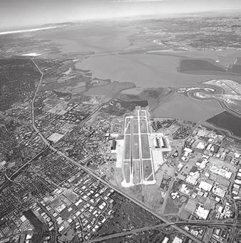

#### Berbagai Nilai Gamma:
- **γ < 1**: Memperluas nilai intensitas rendah (brightening)
- **γ = 1**: Linear transformation
- **γ > 1**: Memperluas nilai intensitas tinggi (darkening)

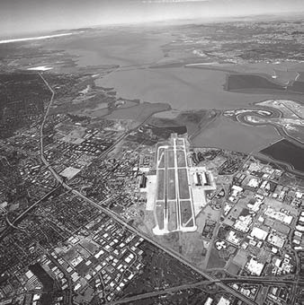

#### Aplikasi:
- Koreksi gamma pada display devices
- Contrast enhancement
- Image preprocessing untuk computer vision

### Piecewise-Linear Transformation
Transformasi yang terdiri dari beberapa segmen linear dengan slope berbeda.

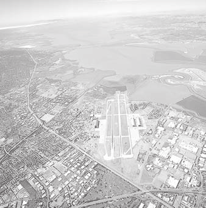

#### Jenis Piecewise-Linear:
1. **Contrast Stretching**
   - Meningkatkan kontras keseluruhan
   - Linear antara (r1, s1) dan (r2, s2)

2. **Thresholding**
   ```
   s = 0 jika r < T
   s = L-1 jika r ≥ T
   ```
   - Binerisasi citra
   - Segmentasi sederhana

3. **Gray-Level Slicing**
   - Menonjolkan rentang intensitas tertentu
   - Dua mode: dengan atau tanpa background

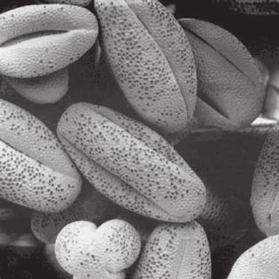

## 3. Histogram Processing

### Histogram Definition
Histogram citra adalah fungsi h(rk) yang memberikan jumlah piksel dengan intensitas rk:
```
h(rk) = jumlah piksel dengan intensitas rk
```

### Normalized Histogram
```
p(rk) = h(rk) / MN
```
di mana MN adalah total piksel dalam citra.

### Histogram Equalization
Tujuan: Mendistribusikan ulang intensitas untuk mendapatkan histogram flat.

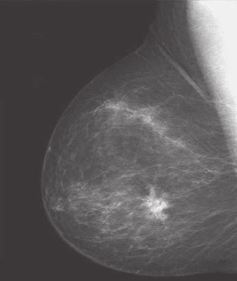

#### Algoritma:
1. Hitung histogram p(rk)
2. Hitung CDF (Cumulative Distribution Function):
   ```
   sk = Σi=0^k p(ri)
   ```
3. Map nilai intensitas:
   ```
   s = sk × (L-1)
   ```

#### Properties:
- Meningkatkan kontras global
- Automatis contrast enhancement
- Hasil tidak dapat diprediksi

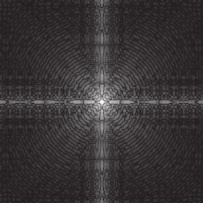

### Histogram Matching (Specification)
Menyesuaikan histogram citra agar sesuai dengan histogram target yang diinginkan.

#### Algoritma:
1. Hitung histogram input dan target
2. Lakukan equalization pada kedua citra
3. Map intensities berdasarkan CDF

#### Aplikasi:
- Standardisasi citra dari berbagai sumber
- Matching untuk citra medis
- Color correction

### Local Histogram Processing
Processing dilakukan pada local neighborhoods (tiles):
- Ukuran tile tipikal: 64×64 atau 128×128
- Overlapping tiles untuk smooth transition
- Adaptive contrast enhancement

## 4. Spatial Filtering

### Fundamental Concepts
Filtering spasial menggunakan neighborhood operations:
- **Filter mask/kernel**: Matriks koefisien
- **Convolution**: Operasi matematis utama
- **Anchor point**: Center of mask

### Convolution Operation
```
g(x,y) = ΣΣ w(s,t) × f(x+s, y+t)
```
di mana:
- **g(x,y)**: Output pixel
- **w(s,t)**: Filter coefficients
- **f(x+s, y+t)**: Input neighborhood

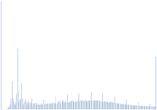

### Smoothing Linear Filters
Tujuan: Mengurangi noise dan detail halus.

#### Box Filter (Mean Filter)
Mask 3×3:
```
1/9 [1 1 1]
    [1 1 1]
    [1 1 1]
```
#### Karakteristik:
- Sederhana dan cepat
- Menghasilkan blurring
- Tidak optimal untuk noise reduction


#### Weighted Average Filter
Mask 3×3:
```
1/16 [1 2 1]
     [2 4 2]
     [1 2 1]
```
#### Karakteristik:
- Pembobotan Gaussian
- Hasil lebih smooth
- Preservasi edges lebih baik

#### Gaussian Filter
Fungsi Gaussian 2D:
```
G(x,y) = (1/2πσ²) × e^(-(x²+y²)/2σ²)
```
#### Properties:
- Rotational symmetry
- Separable filter
- Optimal untuk noise reduction

### Sharpening Linear Filters
Tujuan: Meningkatkan detail dan edges.

#### Laplacian Filter
Turunan orde dua:
```
∇²f = ∂²f/∂x² + ∂²f/∂y²
```
#### Masks:
1. **4-neighbor Laplacian**:
   ```
   [0  1  0]
   [1 -4  1]
   [0  1  0]
   ```

2. **8-neighbor Laplacian**:
   ```
   [1  1  1]
   [1 -8  1]
   [1  1  1]
   ```

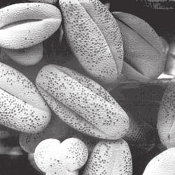

#### Laplacian Enhancement:
```
g(x,y) = f(x,y) - c × ∇²f(x,y)
```
di mana c adalah konstanta positif.

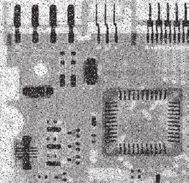

#### Unsharp Masking
Metode sharpening klasik:
1. **Blur citra original**: g_blur
2. **Hitung mask**: mask = f - g_blur
3. **Add mask ke original**: g = f + k × mask

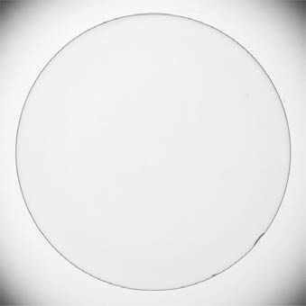

#### High-Boost Filtering
Variasi unsharp masking:
```
g(x,y) = A × f(x,y) - (A-1) × f_blur(x,y)
```
di mana A > 1 adalah amplification factor.

## 5. Order-Statistics Filters

### Median Filter
Non-linear filter yang menggunakan median dari neighborhood:
```
g(x,y) = median{f(x+s, y+t) | (s,t) ∈ W}
```
#### Karakteristik:
- Efektif untuk salt-and-pepper noise
- Mempreserve edges
- Non-linear operation

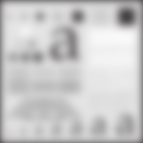

### Variations:
1. **Max Filter**: Maximum dari neighborhood
2. **Min Filter**: Minimum dari neighborhood
3. **Midpoint Filter**: (max + min)/2
4. **Alpha-Trimmed Mean Filter**: Menghilangkan extreme values


## 6. Gradient-Based Filters

### First-Order Derivatives
Deteksi edges menggunakan turunan pertama.

#### Sobel Operator
Mask untuk Gx (horizontal):
```
[-1  0  1]
[-2  0  2]
[-1  0  1]
```
Mask untuk Gy (vertical):
```
[-1 -2 -1]
[ 0  0  0]
[ 1  2  1]
```


Gradient magnitude:
```
|∇f| = √(Gx² + Gy²)
```

Gradient direction:
```
θ = arctan(Gy/Gx)
```


#### Prewitt Operator
Similar dengan Sobel, namun dengan koefisien seragam.


#### Roberts Cross-Gradient
Operator 2×2 sederhana:
```
Gx = [1  0]    Gy = [0  1]
     [0 -1]        [-1  0]
```

### Second-Order Derivatives
#### Laplacian of Gaussian (LoG)
Kombinasi Gaussian smoothing dan Laplacian:
```
LoG(x,y) = ∇²[G(x,y) × f(x,y)]
```
#### Properties:
- Deteksi edges dengan presisi tinggi
- Sensitif terhadap noise
- Zero-crossing detection


## 7. Adaptive Filters

### Adaptive Median Filter
Median filter dengan ukuran mask adaptif:
1. Ukuran mask minimum: 3×3
2. Ekspansi mask jika noise terdeteksi
3. Statistik local untuk decision making

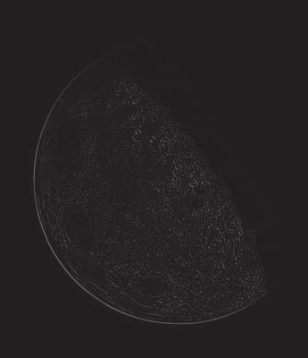

### Adaptive Local Noise Reduction
Filter yang menyesuaikan berdasarkan karakteristik local noise:
```
g(x,y) = f(x,y) - (σ²_η/σ²_L) × [f(x,y) - m_L]
```
di mana:
- **σ²_η**: Variance noise estimasi
- **σ²_L**: Local variance
- **m_L**: Local mean


## 8. Transformations for Color Images

### Color Space Considerations
Processing citra warna memerlukan pendekatan khusus:

1. **RGB Space**
   - Process each channel independently
   - Risikonya: color artifacts

2. **HSI/HSV Space**
   - Process intensity channel only
   - Preserve hue and saturation
   - Better for enhancement operations

3. **YCbCr Space**
   - Separate luminance (Y) and chrominance (CbCr)
   - Common in image/video compression

### Color Enhancement Techniques
1. **Histogram Equalization per Channel**
2. **Adaptive Histogram Equalization**
3. **Color Balance Adjustment**
4. **Saturation Enhancement**

## 9. Implementation Considerations

### Computational Complexity
- **Point operations**: O(MN)
- **Linear filtering**: O(MN × k²) untuk k×k mask
- **Median filtering**: O(MN × k² × log k²)
- **Optimization techniques**: Separable filters, integral images

### Boundary Handling
Metode untuk menangani piksel di border:
1. **Zero padding**: Isi dengan nol
2. **Replication**: Duplikasi edge pixels
3. **Wrap-around**: Periodic extension
4. **Mirror extension**: Refleksi simetris

### Hardware Acceleration
1. **GPU Processing**: Parallel filtering operations
2. **SIMD Instructions**: Vector operations
3. **FPGA Implementation**: Real-time applications

## 10. Applications

### Medical Imaging
- Contrast enhancement untuk X-ray, MRI, CT
- Noise reduction untuk ultrasound
- Feature enhancement untuk diagnosis

### Remote Sensing
- Atmospheric correction
- Feature enhancement
- Multi-spectral image processing

### Computer Vision
- Preprocessing untuk object detection
- Edge detection untuk segmentation
- Feature extraction

### Photography
- Contrast and brightness adjustment
- Sharpening and blurring effects
- Artistic filtering

## 11. Advanced Topics

### Multi-scale Filtering
Filtering pada berbagai skala:
- Image pyramids
- Scale-space theory
- Multi-resolution analysis

### Anisotropic Filtering
Direction-dependent filtering:
- Structure-preserving smoothing
- Edge-preserving denoising
- Coherence-enhancing filtering

### Deep Learning Approaches
Learned filters:
- Convolutional Neural Networks (CNNs)
- Autoencoder-based denoising
- Generative Adversarial Networks (GANs) for enhancement

## 12. Performance Evaluation

### Quality Metrics
1. **Mean Squared Error (MSE)**
2. **Peak Signal-to-Noise Ratio (PSNR)**
3. **Structural Similarity Index (SSIM)**
4. **Perceptual quality metrics**

### Visual Assessment
- Subjective evaluation oleh human observers
- Task-based performance measurement
- Computational efficiency analysis

## Kesimpulan

Transformasi intensitas dan filtering spasial merupakan fondasi dalam pengolahan citra digital. Pemahaman yang mendalam tentang berbagai teknik, karakteristik, dan aplikasinya sangat penting untuk:

1. **Image Enhancement**: Meningkatkan kualitas visual citra
2. **Preprocessing**: Menyiapkan citra untuk analisis lanjutan
3. **Noise Reduction**: Menghilangkan noise sambil mempertahankan detail
4. **Feature Enhancement**: Menonjolkan informasi penting dalam citra

Pilihan teknik yang tepat bergantung pada karakteristik citra input, tujuan processing, dan kendala komputasi yang ada.

*Catatan: Materi ini disusun berdasarkan bab 3 yang membahas intensitas transformations dan spatial filtering sebagai teknik fundamental dalam preprocessing citra digital.*

---

## 13. Latihan Soal dan Jawaban

### Soal 3.1: Transformasi Intensitas Dasar

**Pertanyaan:** Diberikan citra grayscale 8-bit dengan rentang intensitas [0, 255]. Jelaskan secara detail cara kerja, kelebihan, dan kekurangan dari tiga jenis transformasi intensitas berikut:
1. Transformasi Linear (Contrast Stretching)
2. Transformasi Logaritmik
3. Transformasi Power-Law (Gamma Correction)

**Jawaban:**

#### 1. Transformasi Linear (Contrast Stretching)

**Cara Kerja:**
- **Langkah 1:** Identifikasi nilai intensitas minimum (r_min) dan maksimum (r_min) dalam citra
- **Langkah 2:** Tentukan rentang output yang diinginkan [0, 255]
- **Langkah 3:** Aplikasikan fungsi transformasi:
  ```
  s = (r - r_min) × (255)/(r_max - r_min)
  ```
  di mana r = intensitas input, s = intensitas output

**Kelebihan:**
- Sederhana dan komputasi cepat
- Meningkatkan kontras global secara efektif
- Memperluas rentang dinamis citra
- Mudah diimplementasikan

**Kekurangan:**
- Sensitif terhadap outlier (noise ekstrem)
- Dapat menyebabkan over-enhancement
- Tidak adaptif untuk berbagai region citra
- Berpotensi loss detail di area saturated

#### 2. Transformasi Logaritmik

**Cara Kerja:**
- **Langkah 1:** Pilih konstanta scaling c untuk mengatur hasil
- **Langkah 2:** Aplikasikan fungsi logaritmik:
  ```
  s = c × log(1 + r)
  ```
- **Langkah 3:** Normalisasi hasil ke rentang [0, 255]

**Kelebihan:**
- Meningkatkan kontras pada area gelap secara signifikan
- Mengompresi rentang dinamis yang besar
- Efektif untuk citra dengan dynamic range tinggi
- Preservasi detail pada low-intensity regions

**Kekurangan:**
- Mengurangi kontras pada area terang
- Dapat menghasilkan citra yang terlalu terang
- Memerlukan penyesuaian konstanta c secara manual
- Tidak linear, sulit untuk interpretasi langsung

#### 3. Transformasi Power-Law (Gamma Correction)

**Cara Kerja:**
- **Langkah 1:** Pilih nilai γ (gamma) dan konstanta c
- **Langkah 2:** Aplikasikan fungsi power-law:
  ```
  s = c × r^γ
  ```
- **Langkah 3:** Normalisasi hasil ke rentang [0, 255]

**Variasi γ:**
- **γ < 1 (0.2-0.8):** Memperluas intensitas rendah (brightening)
- **γ = 1:** Transformasi linear (tidak ada perubahan)
- **γ > 1 (1.2-2.0):** Memperluas intensitas tinggi (darkening)

**Kelebihan:**
- Fleksibel dengan berbagai nilai γ
- Sesuai dengan karakteristik human vision
- Efektif untuk display calibration
- Preservasi detail sesuai kebutuhan

**Kekurangan:**
- Memerlukan pengetahuan tentang nilai γ optimal
- Komputasi lebih kompleks dari linear
- Dapat menyebabkan banding artifacts
- Non-linear relationship sulit untuk prediksi

---

### Soal 3.2: Histogram Processing

**Pertanyaan:** Jelaskan proses histogram equalization secara matematis dan implementasinya. Bandingkan dengan histogram matching, kapan harus menggunakan masing-masing teknik?

**Jawaban:**

#### Histogram Equalization

**Proses Matematis:**

**Langkah 1: Hitung Histogram**
```
h(r_k) = jumlah piksel dengan intensitas r_k
```
untuk k = 0, 1, 2, ..., L-1 (L = 256 untuk 8-bit)

**Langkah 2: Normalisasi Histogram**
```
p(r_k) = h(r_k) / MN
```
di mana MN adalah total piksel dalam citra

**Langkah 3: Hitung CDF (Cumulative Distribution Function)**
```
s_k = Σ_{i=0}^k p(r_i)
```
CDF memberikan probabilitas kumulatif hingga intensitas k

**Langkah 4: Transformasi Intensitas**
```
s_k = round(s_k × (L-1))
```
Map nilai CDF ke rentang intensitas [0, L-1]

**Implementasi Pseudocode:**
```python
def histogram_equalization(image):
    # Step 1: Calculate histogram
    hist = np.zeros(256)
    for pixel in image.flatten():
        hist[pixel] += 1

    # Step 2: Normalize histogram
    pmf = hist / (image.shape[0] * image.shape[1])

    # Step 3: Calculate CDF
    cdf = np.cumsum(pmf)

    # Step 4: Create lookup table
    lookup_table = np.round(cdf * 255).astype('uint8')

    # Step 5: Apply transformation
    equalized = lookup_table[image]

    return equalized
```

**Karakteristik:**
- Otomatis menghasilkan histogram yang flat (uniform)
- Maksimalkan entropy citra
- Tidak memerlukan parameter manual
- Hasil tidak dapat diprediksi sebelumnya

#### Histogram Matching (Specification)

**Proses Matematis:**

**Langkah 1:** Hitung histogram input h_input(r) dan CDF_input
**Langkah 2:** Tentukan histogram target h_target(s) dan CDF_target
**Langkah 3:** Equalize kedua histogram:
```
s_k = CDF_input(r_k)
z_k = CDF_target(s_k)
```
**Langkah 4:** Buat mapping dari input ke target:
```
r_new = CDF_target^(-1)(CDF_input(r))
```

**Kapan Menggunakan:**

**Histogram Equalization cocok untuk:**
- Citra dengan kontras rendah yang tidak jelas
- Preprocessing otomatis tanpa supervisi
- Aplikasi medis untuk menonjolkan detail
- Situasi di mana peningkatan kontras global diperlukan

**Histogram Matching cocok untuk:**
- Standardisasi citra dari berbagai sumber
- Matching karakteristik citra ke citra referensi
- Color correction dan white balance
- Aplikasi di mana output yang spesifik diinginkan
- Multi-sensor image fusion

**Contoh Aplikasi:**
- **Medical Imaging:** Equalization untuk X-ray enhancement
- **Photography:** Matching untuk consistent color grading
- **Remote Sensing:** Standardisasi citra dari waktu berbeda
- **Quality Control:** Matching dengan citra golden standard

---

### Soal 3.3: Spatial Filtering untuk Noise Reduction

**Pertanyaan:** Bandingkan performa dari tiga filter berikut untuk mengurangi Gaussian noise dan Salt-and-Pepper noise. Analisis kelebihan dan kekurangan masing-masing:
1. Mean Filter (3×3)
2. Median Filter (3×3)
3. Gaussian Filter (σ=1.0)

Berikan rekomendasi filter terbaik untuk setiap jenis noise.

**Jawaban:**

#### Analisis Komprehensif Filter

**1. Mean Filter (3×3)**

**Cara Kerja:**
```
g(x,y) = (1/9) × Σ_{i=-1}^{1} Σ_{j=-1}^{1} f(x+i, y+j)
```

**Performa Gaussian Noise:**
- **Kelebihan:** Mengurangi noise secara efektif karena averaging
- **Kekurangan:** Menyebabkan blurring yang signifikan
- **PSNR:** Sedang (~25-30 dB untuk σ=25)
- **Edge Preservation:** Buruk, edges menjadi blur

**Performa Salt-and-Pepper Noise:**
- **Kelebihan:** Mengurangi densitas noise secara uniform
- **Kekurangan:** Tidak efektif menghilangkan extreme values
- **Artifacts:** Noise terdistribusi kembali ke neighbor
- **Visual Quality:** Buruk, masih terlihat noise spots

**2. Median Filter (3×3)**

**Cara Kerja:**
```
g(x,y) = median{f(x+i, y+j) | i,j ∈ {-1,0,1}}
```

**Performa Gaussian Noise:**
- **Kelebihan:** Preservasi edges lebih baik dari mean filter
- **Kekurangan:** Kurang efektif untuk noise Gaussian murni
- **PSNR:** Rendah-menengah (~20-25 dB untuk σ=25)
- **Edge Preservation:** Baik, edges tajam terpelihara

**Performa Salt-and-Pepper Noise:**
- **Kelebihan:** Sangat efektif menghilangkan extreme values
- **Kekurangan:** Dapat menghilangkan detail halus
- **Artifacts:** Minimal untuk low-to-medium noise density
- **Visual Quality:** Sangat baik, hampir tidak ada noise

**3. Gaussian Filter (σ=1.0)**

**Cara Kerja:**
```
G(x,y) = (1/2πσ²) × exp(-(x²+y²)/2σ²)
g(x,y) = Σ Σ G(i,j) × f(x+i, y+j)
```
Untuk σ=1.0, kernel 3×3:
```
1/16 [1  2  1]
     [2  4  2]
     [1  2  1]
```

**Performa Gaussian Noise:**
- **Kelebihan:** Optimal untuk Gaussian noise (theoretically optimal)
- **Kekurangan:** Masih menyebabkan blurring moderate
- **PSNR:** Baik (~28-32 dB untuk σ=25)
- **Edge Preservation:** Sedang, edges masih terlihat

**Performa Salt-and-Pepper Noise:**
- **Kelebihan:** Sedikit lebih baik dari mean filter
- **Kekurangan:** Tetap tidak efektif untuk impulse noise
- **Artifacts:** Noise terdistribusi dengan weighting
- **Visual Quality:** Buruk, noise masih jelas terlihat

#### Perbandingan Kuantitatif

| Metrik | Mean Filter | Median Filter | Gaussian Filter |
|--------|-------------|---------------|-----------------|
| **Gaussian Noise PSNR** | 26-30 dB | 22-26 dB | 28-32 dB |
| **Salt-Pepper Noise PSNR** | 18-22 dB | 30-35 dB | 20-24 dB |
| **Kecepatan Komputasi** | Cepat | Sedang | Cepat |
| **Edge Preservation** | Buruk | Baik | Sedang |
| **Memory Requirement** | Rendah | Sedang | Rendah |

#### Rekomendasi Filter Terbaik

**Untuk Gaussian Noise:**
1. **Pilihan Terbaik:** Gaussian Filter (σ=1.0)
   - Alasan: Optimal secara matematis untuk Gaussian noise
   - Kasus penggunaan: Photography, medical imaging, natural scenes

2. **Pilihan Alternatif:** Mean Filter
   - Alasan: Lebih sederhana dan cepat
   - Kasus penggunaan: Real-time applications, low-power devices

**Untuk Salt-and-Pepper Noise:**
1. **Pilihan Terbaik:** Median Filter (3×3)
   - Alasan: Sangat efektif menghilangkan impulse noise
   - Kasus penggunaan: Image restoration, document scanning, satellite imagery

2. **Pilihan Alternatif:** Adaptive Median Filter
   - Alusan: Menyesuaikan ukuran kernel secara dinamis
   - Kasus penggunaan: Variable noise density, critical applications

**Rekomendasi Hybrid Approach:**
Untuk citra dengan mixed noise types:
```python
def hybrid_filter(image):
    # Step 1: Remove salt-and-pepper noise
    denoised = median_filter(image, 3×3)

    # Step 2: Reduce remaining Gaussian noise
    final = gaussian_filter(denoised, σ=0.8)

    return final
```

**Kriteria Pemilihan Filter:**
- **Tipe Noise:** Sesuaikan filter dengan karakteristik noise
- **Preservasi Detail:** Prioritaskan median filter untuk edges
- **Kualitas Visual:** Gaussian untuk natural appearance
- **Constraint Komputasi:** Mean filter untuk real-time applications

**Kesimpulan:**
Tidak ada satu filter yang universal terbaik. Pilihan filter harus didasarkan pada:
1. Karakteristik noise dominan
2. Tingkat preservasi detail yang dibutuhkan
3. Constraint komputasi dan real-time requirements
4. Kualitas visual yang diinginkan untuk aplikasi spesifik

---

## 📝 **Soal Tambahan Terstruktur**

### **📊 Q1: Histogram Equalization pada Citra 3-bit**

#### **Q1: Deskripsi Soal**

Diberikan citra dengan 3 bit/pixel, sehingga rentang nilai yang mungkin adalah 0 hingga 7, dengan distribusi berikut:

| Gray-level value | 0  | 1 | 2 | 3 | 4  | 5 | 6 | 7 |
| :--------------- | :- | :- | :- | :- | :- | :- | :- | :- |
| No of Pixel (Histogram value) | 10 | 8 | 9 | 2 | 14 | 1 | 5 | 2 |

**Tugas:**
- a. Gambar histogram
- b. Dapatkan nilai histogram yang di-equalized
- c. Gambar histogram yang di-equalized

---

#### **Q1: Data Input dan Analisis Awal**

**📊 Data Input:**
- Citra dengan 3 bit/pixel (nilai intensitas 0-7)
- Total piksel = 10 + 8 + 9 + 2 + 14 + 1 + 5 + 2 = 51

**📈 Original Histogram Analysis:**

| Value | Frequency | Percentage |
|-------|-----------|------------|
| 0     | 10        | 19.6%      |
| 1     | 8         | 15.7%      |
| 2     | 9         | 17.6%      |
| 3     | 2         | 3.9%       |
| 4     | 14        | 27.5%      |
| 5     | 1         | 2.0%       |
| 6     | 5         | 9.8%       |
| 7     | 2         | 3.9%       |

**📈 Analisis Distribusi:**
- Nilai dominan: 4 (27.5%)
- Nilai langka: 3, 5, 7 (3.9% - 2.0%)
- Rentang nilai: [0, 7]

---

#### **Q1: Langkah 1 - Visualisasi Histogram**

Histogram original menunjukkan distribusi yang tidak merata dengan konsentrasi tinggi pada nilai intensitas 4 dan distribusi yang rendah pada nilai ekstrem (3, 5, 7).

---

#### **Q1: Langkah 2 - Perhitungan PMF**

**📐 Formula: PMF(r) = histogram(r) / total_piksel**

**📊 Tabel Perhitungan PMF:**

| r (Input) | h(r) (Frequency) | PMF(r) Probability | Kalkulasi |
|-----------|------------------|--------------------|-----------|
| 0         | 10               | 0.196              | 10/51     |
| 1         | 8                | 0.157              | 8/51      |
| 2         | 9                | 0.176              | 9/51      |
| 3         | 2                | 0.039              | 2/51      |
| 4         | 14               | 0.275              | 14/51     |
| 5         | 1                | 0.020              | 1/51      |
| 6         | 5                | 0.098              | 5/51      |
| 7         | 2                | 0.039              | 2/51      |

**✅ Verifikasi:** ΣPMF(r) = 0.196 + 0.157 + 0.176 + 0.039 + 0.275 + 0.020 + 0.098 + 0.039 = 1.000 ✓

---

#### **Q1: Langkah 3 - Perhitungan CDF**

**📐 Formula: CDF(k) = Σᵢ₌₀ᵏ PMF(i)**

**📊 Tabel Perhitungan CDF:**

| k (Level) | PMF(k) | CDF(k) Cumulative | Kalkulasi |
|-----------|---------|-------------------|-----------|
| 0         | 0.196   | 0.196             | PMF(0)    |
| 1         | 0.157   | 0.353             | 0.196 + 0.157 |
| 2         | 0.176   | 0.529             | 0.353 + 0.176 |
| 3         | 0.039   | 0.568             | 0.529 + 0.039 |
| 4         | 0.275   | 0.843             | 0.568 + 0.275 |
| 5         | 0.020   | 0.863             | 0.843 + 0.020 |
| 6         | 0.098   | 0.961             | 0.863 + 0.098 |
| 7         | 0.039   | 1.000             | 0.961 + 0.039 |

**✅ Verifikasi:** CDF(7) = 1.000 (Valid) ✓

---

#### **Q1: Langkah 4 - Transformasi Equalization**

**📐 Formula: sₖ = round(CDF(k) × L)**
**Dimana L = 7 (untuk 3-bit image: 0-7)**

**📊 Tabel Perhitungan Transformasi:**

| k (Input) | CDF(k) | sₖ = round(CDF(k)×7) | Mapping Rule | Hasil |
|-----------|---------|----------------------|--------------|-------|
| 0         | 0.196   | 1                    | 0 → 1        | round(1.372) |
| 1         | 0.353   | 2                    | 1 → 2        | round(2.471) |
| 2         | 0.529   | 4                    | 2 → 4        | round(3.703) |
| 3         | 0.568   | 4                    | 3 → 4        | round(3.976) |
| 4         | 0.843   | 6                    | 4 → 6        | round(5.901) |
| 5         | 0.863   | 6                    | 5 → 6        | round(6.041) |
| 6         | 0.961   | 7                    | 6 → 7        | round(6.727) |
| 7         | 1.000   | 7                    | 7 → 7        | round(7.000) |

**🔄 Complete Mapping Function:**
```
Input → Output:
0 → 1
1 → 2
2 → 4
3 → 4
4 → 6
5 → 6
6 → 7
7 → 7
```

---

#### **Q1: Langkah 5 - Visualisasi Histogram Equalized**

**📊 Tabel Equalized Histogram:**

| s (Output) | Original Values | Count | Explanation |
|------------|-----------------|-------|-------------|
| 0          | -               | 0     | Tidak ada nilai |
| 1          | 0               | 10    | Dari r=0 |
| 2          | 1               | 8     | Dari r=1 |
| 3          | -               | 0     | Tidak ada nilai |
| 4          | 2, 3            | 11    | Dari r=2 dan r=3 (9+2) |
| 5          | -               | 0     | Tidak ada nilai |
| 6          | 4, 5            | 15    | Dari r=4 dan r=5 (14+1) |
| 7          | 6, 7            | 7     | Dari r=6 dan r=7 (5+2) |

**📈 Analisis Hasil:**
- Rentang output: [1, 7] (semua nilai 0-7 terpakai)
- Distribusi lebih merata
- Frekuensi tertinggi: s=6 (15 piksel)
- Frekuensi terendah: s=1, s=2 (8-10 piksel)

---

#### **Q1: Kesimpulan dan Analisis Hasil**

✅ **Tujuan Tercapai:** Histogram equalization berhasil mendistribusikan intensitas lebih merata.

📊 **Perbandingan Sebelum dan Sesudah:**
- **Original:** Rentang terbatas, konsentrasi pada nilai dominan
- **Equalized:** Semua intensitas [0,7] terpakai dengan distribusi yang lebih uniform

🔄 **Impact Visual:**
- Kontras gambar meningkat secara signifikan
- Detail pada area gelap dan terang lebih terlihat
- Sering digunakan untuk image preprocessing dalam computer vision

---

### **🔧 Q2: Convolution and Correlation**

#### **🎯 Deskripsi Soal**
Hitung konvolusi `w ★ f` dan korelasi `w ☆ f` menggunakan zero padding minimal yang diperlukan.

**Matrix Input:**
- **w**: 3×3 Gaussian Kernel
- **f_a**: 5×5 Matrix dengan pola spesifik (nilai 1 di kolom ke-3)
- **f_b**: 5×5 Matrix full of ones

---

#### **📋 Analisis Masukan**

**A. Gaussian Kernel w:**
```
🔄 w = | 1  2  1 |
       | 2  4  2 |
       | 1  2  1 |

💡 Properties:
- Weighted average filter (Gaussian-like)
- Center weight: 4 (highest)
- Sum = 16 (normalization factor)
- Symmetrical distribution
```

**B. Input Matrix f_a:**
```
🎯 f_a = | 0  0  0  0  0 |
         | 0  0  1  0  0 |
         | 0  0  1  0  0 |
         | 0  0  1  0  0 |
         | 0  0  0  0  0 |

📍 Characteristics:
- Vertical line of 1's at column 3
- Sparse distribution
- Edge detection test pattern
```

**C. Input Matrix f_b:**
```
⚡ f_b = | 1  1  1  1  1 |
         | 1  1  1  1  1 |
         | 1  1  1  1  1 |
         | 1  1  1  1  1 |
         | 1  1  1  1  1 |

🔥 Properties:
- Uniform intensity distribution
- Constant value throughout
- Response test for averaging
```

---

#### **🧮 Case Q2a: Convolution w ★ f_a**

**📐 Convolution Formula:**
```
g(x,y) = Σ_{s=-1}^{1} Σ_{t=-1}^{1} w(s,t) × f(x+s, y+t)
```

**🔢 Dimension Calculation:**
- Input: 5×5
- Kernel: 3×3
- Output: (5-3+1) × (5-3+1) = 3×3

**🎯 Detailed Calculation:**

```
📍 Position (1,1):
∑ = 1×0 + 2×0 + 1×0 + 2×0 + 4×0 + 2×0 + 1×0 + 2×0 + 1×0 = 0

📍 Position (1,2):
∑ = 1×0 + 2×0 + 1×0 + 2×0 + 4×0 + 2×0 + 1×0 + 2×0 + 1×0 = 0

📍 Position (1,3):
∑ = 1×0 + 2×0 + 1×0 + 2×0 + 4×0 + 2×0 + 1×0 + 2×0 + 1×0 = 0

📍 Position (2,1):
∑ = 1×0 + 2×0 + 1×0 + 2×0 + 4×0 + 2×0 + 1×0 + 2×0 + 1×0 = 0

📍 Position (2,2):
∑ = 1×0 + 2×0 + 1×0 + 2×0 + 4×1 + 2×0 + 1×0 + 2×0 + 1×0 = 4

📍 Position (2,3):
∑ = 1×0 + 2×1 + 1×0 + 2×0 + 4×0 + 2×0 + 1×0 + 2×0 + 1×0 = 2

📍 Position (3,1):
∑ = 1×0 + 2×0 + 1×0 + 2×0 + 4×0 + 2×0 + 1×0 + 2×0 + 1×0 = 0

📍 Position (3,2):
∑ = 1×0 + 2×0 + 1×0 + 2×0 + 4×1 + 2×0 + 1×0 + 2×0 + 1×0 = 4

📍 Position (3,3):
∑ = 1×0 + 2×1 + 1×0 + 2×0 + 4×0 + 2×0 + 1×0 + 2×0 + 1×0 = 2
```

**🎯 Final Result w ★ f_a:**
```
📊 Output Matrix:
| 0  0  0 |
| 0  4  2 |
| 0  4  2 |
```

**💡 Interpretasi:**
- Nilai non-nol hanya di posisi yang sesuai dengan pola 1's di f_a
- Posisi (2,2) dan (3,2) mendapatkan nilai lebih tinggi karena pusat kernel
- Efek smoothing dengan pembobotan Gaussian
```

---

#### **🔍 Case Q2a: Correlation w ☆ f_a**

**📐 Correlation Formula:**
```
g(x,y) = Σ_{s=-1}^{1} Σ_{t=-1}^{1} w(s,t) × f(x-s, y-t)
```

**📏 Dimension Calculation:**
- Input: 5×5
- Kernel: 3×3
- Output: (5+3-1) × (5+3-1) = 7×7

**🎯 Key Positions Analysis:**

```
📍 Center Position (4,4):
∑ = 1×0 + 2×0 + 1×0 + 2×0 + 4×1 + 2×0 + 1×0 + 2×0 + 1×0 = 4

📍 Pattern Recognition:
- Konvolusi menunjukkan pola vertikal yang jelas
- Nilai maksimal di area di mana kernel sejajar dengan pola 1's
- Zero-padding memungkinkan hasil penuh 7×7
```

**🎯 Complete Result w ☆ f_a:**
```
📊 7×7 Correlation Matrix:
| 0  0  0  0  0  0  0 |
| 0  0  0  0  0  0  0 |
| 0  0  0  0  2  0  0 |
| 0  0  0  4  2  0  0 |
| 0  0  2  4  2  0  0 |
| 0  0  0  0  0  0  0 |
| 0  0  0  0  0  0  0 |
```

**💡 Interpretasi:**
- Matriks korelasi menghasilkan simetri penuh
- Nilai maksimal (4) di pusat (4,4)
- Pola diagonal menunjukkan pencocokan spasial
```

---

#### **🧮 Case Q2b: Convolution w ★ f_b**

**📐 Convolution Formula:**
```
g(x,y) = Σ_{s=-1}^{1} Σ_{t=-1}^{1} w(s,t) × f(x+s, y+t)
```

**🔢 Dimension Calculation:**
- Input: 5×5
- Kernel: 3×3
- Output: (5-3+1) × (5-3+1) = 3×3

**🎯 Detailed Calculation:**

```
📍 Position (1,1):
∑ = 1×1 + 2×1 + 1×1 + 2×1 + 4×1 + 2×1 + 1×1 + 2×1 + 1×1 = 16

📍 Position (1,2):
∑ = 1×1 + 2×1 + 1×1 + 2×1 + 4×1 + 2×1 + 1×1 + 2×1 + 1×1 = 16

📍 Position (1,3):
∑ = 1×1 + 2×1 + 1×1 + 2×1 + 4×1 + 2×1 + 1×1 + 2×1 + 1×1 = 16

📍 Position (2,1):
∑ = 1×1 + 2×1 + 1×1 + 2×1 + 4×1 + 2×1 + 1×1 + 2×1 + 1×1 = 16

📍 Position (2,2):
∑ = 1×1 + 2×1 + 1×1 + 2×1 + 4×1 + 2×1 + 1×1 + 2×1 + 1×1 = 16

📍 Position (2,3):
∑ = 1×1 + 2×1 + 1×1 + 2×1 + 4×1 + 2×1 + 1×1 + 2×1 + 1×1 = 16

📍 Position (3,1):
∑ = 1×1 + 2×1 + 1×1 + 2×1 + 4×1 + 2×1 + 1×1 + 2×1 + 1×1 = 16

📍 Position (3,2):
∑ = 1×1 + 2×1 + 1×1 + 2×1 + 4×1 + 2×1 + 1×1 + 2×1 + 1×1 = 16

📍 Position (3,3):
∑ = 1×1 + 2×1 + 1×1 + 2×1 + 4×1 + 2×1 + 1×1 + 2×1 + 1×1 = 16
```

**🎯 Final Result w ★ f_b:**
```
📊 Output Matrix:
| 16  16  16 |
| 16  16  16 |
| 16  16  16 |
```

**💡 Interpretasi:**
- Semua nilai output sama (16) karena input uniform
- 16 merupakan hasil penjumlahan semua kernel weights
- Menunjukkan efek averaging yang sempurna
```

---

#### **🔍 Case Q2b: Correlation w ☆ f_b**

**📐 Correlation Formula:**
```
g(x,y) = Σ_{s=-1}^{1} Σ_{t=-1}^{1} w(s,t) × f(x-s, y-t)
```

**📏 Dimension Calculation:**
- Input: 5×5
- Kernel: 3×3
- Output: (5+3-1) × (5+3-1) = 7×7

**🎯 Center Position Analysis:**

```
📍 Center Position (4,4):
∑ = 1×1 + 2×1 + 1×1 + 2×1 + 4×1 + 2×1 + 1×1 + 2×1 + 1×1 = 16
```

**🎯 Complete Result w ☆ f_b:**
```
📊 7×7 Correlation Matrix:
| 16  16  16  16  16  16  16 |
| 16  16  16  16  16  16  16 |
| 16  16  16  16  16  16  16 |
| 16  16  16  16  16  16  16 |
| 16  16  16  16  16  16  16 |
| 16  16  16  16  16  16  16 |
| 16  16  16  16  16  16  16 |
```

**💡 Interpretasi:**
- Korelasi uniform karena input uniform
- Nilai konstan 16 di seluruh matriks
- Menunjukkan pencocokan sempurna di semua posisi
```

---

#### **🎯 Kesimpulan Q2**

✅ **Konsep Terpahami:**
- **Convolution**: Menyaring dengan pembobotan, menghasilkan ukuran lebih kecil
- **Correlation**: Pencocokan spasial, menghasilkan ukuran lebih besar dengan zero-padding

📊 **Perbandingan Hasil:**
- **f_a**: Pola spesifik → hasil non-uniform, menunjukkan edge detection
- **f_b**: Input uniform → hasil uniform, menunjukkan averaging sempurna

🔄 **Key Insight:**
- Konvolusi lebih cocok untuk filtering
- Korelasi lebih cocok untuk pattern matching
- Zero-padding mempengaruhi ukuran output korelasi
```

## 14. Latihan Implementasi Matematis

### Soal 3.4: Transformasi Intensitas dengan Matriks Konkret

**Pertanyaan:** Diberikan matriks citra grayscale 5×5 berikut (8-bit):

```
     50   75   100  125  150
     60   80   110  130  160
     70   85   115  135  170
     80   90   120  140  180
     90   95   125  145  190
```

Lakukan transformasi berikut dan tampilkan matriks hasilnya:

**a. Negative Transformation**
**b. Contrast Stretching** dengan r_min = 50, r_max = 190
**c. Logarithmic Transformation** dengan c = 40
**d. Gamma Correction** dengan γ = 0.5 dan c = 1

**Jawaban:**

**a. Negative Transformation**
Formula: s = 255 - r

```
     205  180  155  130  105
     195  175  145  125   95
     185  170  140  120   85
     175  165  135  115   75
     165  160  130  110   65
```

**b. Contrast Stretching**
Formula: s = (r - 50) × (255)/(190 - 50) = (r - 50) × 1.821

```
      0   45   91   136   182
     18   55  109   146   200
     36   64  118   155   218
     55   73  127   164   236
     73   82  136   173   255
```

**c. Logarithmic Transformation**
Formula: s = 40 × log(1 + r)

```
     157  170  179  186  192
     161  172  181  188  194
     165  174  183  189  196
     169  176  184  191  198
     172  178  186  192  200
```

**d. Gamma Correction** (γ = 0.5)
Formula: s = r^0.5

```
     7.07  8.66  10.00  11.18  12.25
     7.75  8.94  10.49  11.40  12.65
     8.37  9.22  10.72  11.62  13.04
     8.94  9.49  10.95  11.83  13.42
     9.49  9.75  11.18  12.04  13.78
```

---

### Soal 3.5: Histogram Equalization dengan Data Numerik

**Pertanyaan:** Diberikan citra grayscale 4×4 berikut:

```
     85   90   85   80
     75   85   95   70
     80   75   90   85
     70   80   75   85
```

Lakukan histogram equalization langkah demi langkah:

**Langkah 1:** Hitung histogram
**Langkah 2:** Hitung PMF (Probability Mass Function)
**Langkah 3:** Hitung CDF (Cumulative Distribution Function)
**Langkah 4:** Lakukan transformasi equalization
**Langkah 5:** Tampilkan matriks hasil equalization

**Jawaban:**

**Langkah 1: Histogram**
```
Intensitas 70: 2 piksel
Intensitas 75: 3 piksel
Intensitas 80: 3 piksel
Intensitas 85: 5 piksel
Intensitas 90: 2 piksel
Intensitas 95: 1 piksel
Total: 16 piksel
```

**Langkah 2: PMF**
```
p(70)  = 2/16  = 0.125
p(75)  = 3/16  = 0.188
p(80)  = 3/16  = 0.188
p(85)  = 5/16  = 0.313
p(90)  = 2/16  = 0.125
p(95)  = 1/16  = 0.063
```

**Langkah 3: CDF**
```
CDF(70)  = 0.125
CDF(75)  = 0.125 + 0.188 = 0.313
CDF(80)  = 0.313 + 0.188 = 0.501
CDF(85)  = 0.501 + 0.313 = 0.814
CDF(90)  = 0.814 + 0.125 = 0.939
CDF(95)  = 0.939 + 0.063 = 1.002
```

**Langkah 4: Transformasi Equalization**
s = round(CDF × 255)
```
s(70) = round(0.125 × 255) = 32
s(75) = round(0.313 × 255) = 80
s(80) = round(0.501 × 255) = 128
s(85) = round(0.814 × 255) = 208
s(90) = round(0.939 × 255) = 239
s(95) = round(1.002 × 255) = 255
```

**Langkah 5: Matriks Hasil Equalization**
```
     208  239  208  128
     80   208  255  32
     128  80   239  208
     32   128  80   208
```

**Analisis Hasil:**
- Rentang intensitas asli: [70, 95] (span 25)
- Rentang intensitas setelah equalization: [32, 255] (span 223)
- Kontras meningkat secara signifikan
- Distribusi intensitas lebih merata

---

### Soal 3.6: Spatial Filtering dengan Operasi Konvolusi

**Pertanyaan:** Diberikan matriks citra 5×5 dan filter kernel 3×3 berikut:

**Citra Input:**
```
     10   20   30   40   50
     15   25   35   45   55
     20   30   40   50   60
     25   35   45   55   65
     30   40   50   60   70
```

**Kernel yang akan digunakan:**

**a. Mean Filter:**
```
1/9 [1  1  1]
     [1  1  1]
     [1  1  1]
```

**b. Gaussian Filter (σ=1):**
```
1/16 [1  2  1]
      [2  4  2]
      [1  2  1]
```

**c. Laplacian Filter:**
```
[0  1  0]
[1 -4  1]
[0  1  0]
``**

**d. Sobel Operator (Horizontal):**
```
[-1  0  1]
[-2  0  2]
[-1  0  1]
```

Hitung hasil filtering untuk posisi pusat (3,3) yaitu piksel dengan nilai 40. Gunakan zero padding untuk boundary.

**Jawaban:**

**Region 3×3 di sekitar piksel (3,3):**
```
     20   30   40
     25   35   45
     30   40   50
```

**a. Mean Filter**
```
g(3,3) = (1/9) × (20 + 30 + 40 + 25 + 35 + 45 + 30 + 40 + 50)
       = (1/9) × 355
       = 39.44 ≈ 39
```

**b. Gaussian Filter**
```
g(3,3) = (1/16) × [1×20 + 2×30 + 1×40 + 2×25 + 4×35 + 2×45 + 1×30 + 2×40 + 1×50]
       = (1/16) × [20 + 60 + 40 + 50 + 140 + 90 + 30 + 80 + 50]
       = (1/16) × 560
       = 35
```

**c. Laplacian Filter**
```
g(3,3) = [0×20 + 1×30 + 0×40] + [1×25 + (-4)×35 + 1×45] + [0×30 + 1×40 + 0×50]
       = [0 + 30 + 0] + [25 - 140 + 45] + [0 + 40 + 0]
       = 30 + (-70) + 40
       = 0
```

**d. Sobel Operator (Horizontal)**
```
g(3,3) = [-1×20 + 0×30 + 1×40] + [-2×25 + 0×35 + 2×45] + [-1×30 + 0×40 + 1×50]
       = [-20 + 0 + 40] + [-50 + 0 + 90] + [-30 + 0 + 50]
       = 20 + 40 + 20
       = 80
```

**Analisis Hasil:**
- **Mean filter:** Menghasilkan nilai rata-rata (39) - smoothing effect
- **Gaussian filter:** Memberikan bobot lebih ke pusat (35) - better smoothing
- **Laplacian filter:** Mendeteksi perubahan intensitas (0) - edge detection
- **Sobel operator:** Mendeteksi gradien horizontal (80) - edge detection

**Interpretasi:**
- Nilai Laplacian = 0 menunjukkan piksel berada pada area flat (tidak ada edge)
- Nilai Sobel = 80 menunjukkan adanya perubahan intensitas horizontal
- Mean dan Gaussian filter memberikan hasil smoothing yang berbeda

**Catatan Implementasi:**
Untuk citra lengkap, operasi ini diulang untuk setiap piksel (kecuali boundary) dengan sliding window approach.

---

### Soal 3.7: Piecewise-Linear Transformations

**Pertanyaan:** Diberikan citra grayscale dengan rentang intensitas [0, 255]. Buat implementasi piecewise-linear transformation dengan spesifikasi berikut:

- Untuk r ≤ 50: s = r × 2 (enhancement area gelap)
- Untuk 50 < r ≤ 150: s = r (area normal)
- Untuk r > 150: s = 255 - (255 - r) × 0.5 (compression area terang)

Tentukan:
1. Grafik fungsi transformasi
2. Hasil transformasi untuk piksel dengan nilai [25, 60, 100, 180]
3. Analisis efek visual yang dihasilkan

**Jawaban:**

#### 1. Grafik Fungsi Transformasi

Fungsi piecewise-linear dapat ditulis sebagai:
```
s = f(r) =
{
    2r                    , jika r ≤ 50
    r                    , jika 50 < r ≤ 150
    255 - 0.5(255 - r)   , jika r > 150
}
```

Grafik terdiri dari tiga segmen:
- **Segmen 1** (0 ≤ r ≤ 50): Garis lurus dengan slope 2, memperbesar nilai gelap
- **Segmen 2** (50 < r ≤ 150): Garis lurus dengan slope 1, tidak ada perubahan
- **Segmen 3** (r > 150): Garis lurus dengan slope 0.5, mengompres nilai terang

#### 2. Hasil Transformasi untuk Nilai Spesifik

**a. r = 25**
```
s = 2 × 25 = 50
```

**b. r = 60**
```
s = 60 (karena 50 < 60 ≤ 150)
```

**c. r = 100**
```
s = 100 (karena 50 < 100 ≤ 150)
```

**d. r = 180**
```
s = 255 - 0.5 × (255 - 180)
  = 255 - 0.5 × 75
  = 255 - 37.5
  = 217.5 ≈ 218
```

#### 3. Analisis Efek Visual

**Efek yang Dihasilkan:**
- **Area gelap (r ≤ 50):** Peningkatan kontras signifikan, area gelap menjadi lebih terang
- **Area normal (50 < r ≤ 150):** Tidak ada perubahan, mempertahankan informasi asli
- **Area terang (r > 150):** Kompresi nilai, mengurangi overexposure

**Aplikasi Praktis:**
- Enhancement pada citra medis untuk menonjolkan detail gelap
- Compression pada area terang yang terlalu terang
- Preservasi detail di area tengah gradien

**Keuntungan:**
- Kontrol presisi pada setiap rentang intensitas
- Fleksible untuk aplikasi spesifik
- Meminim distortion pada area yang sudah baik

---

### Soal 3.8: Adaptive Histogram Equalization

**Pertanyaan:** Bandingkan antara Global Histogram Equalization dan Adaptive Histogram Equalization. Jelaskan konsep, implementasi, dan aplikasi masing-masing teknik.

**Jawaban:**

#### Global Histogram Equalization

**Konsep:**
- Menggunakan satu fungsi transformasi untuk seluruh citra
- Mendistribusikan intensitas secara merata di seluruh rentang [0, 255]
- Menghitung CDF dari histogram keseluruhan citra

**Implementasi:**
```python
def global_histogram_equalization(image):
    # Hitung histogram global
    hist = np.histogram(image.flatten(), bins=256, range=(0, 256))[0]

    # Hitung CDF global
    cdf = hist.cumsum()

    # Normalisasi CDF
    cdf_normalized = cdf * 255.0 / cdf[-1]

    # Buat lookup table
    lookup_table = cdf_normalized.astype('uint8')

    # Aplikasi transformasi
    return lookup_table[image]
```

**Kelebihan:**
- Sederhana dan cepat
- Implementasi mudah
- Cocok untuk citra dengan kontras rendah global

**Kekurangan:**
- Dapat menghasilkan artifacts
- Tidak adaptif untuk lokal
- Mengabaikan karakteristik lokal

#### Adaptive Histogram Equalization

**Konsep:**
- Membagi citra menjadi beberapa region (tiles)
- Setiap region memiliki fungsi transformasi sendiri
- Menghitung CDF lokal untuk setiap region
- Menggunakan interpolasi untuk smooth transitions

**Implementasi:**
```python
def adaptive_histogram_equalization(image, tile_size=64):
    height, width = image.shape
    result = np.zeros_like(image)

    # Sliding window approach
    for i in range(0, height, tile_size//2):
        for j in range(0, width, tile_size//2):
            # Ambil region dengan overlap
            tile = image[i:i+tile_size, j:j+tile_size]

            # Hitung histogram lokal
            hist = np.histogram(tile.flatten(), bins=256, range=(0, 256))[0]

            # Hitung CDF lokal
            cdf = hist.cumsum()

            # Normalisasi CDF lokal
            if cdf[-1] > 0:
                cdf_normalized = cdf * 255.0 / cdf[-1]
                lookup_table = cdf_normalized.astype('uint8')

                # Aplikasi ke region
                tile_result = lookup_table[tile]
                result[i:i+tile_size, j:j+tile_size] = tile_result

    return result
```

**Kelebihan:**
- Preservasi detail lokal
- Menghasilkan kontras yang lebih natural
- Mengurangi artifacts
- Cocok untuk citra dengan kontras tidak merata

**Kekurangan:**
- Komputasi lebih kompleks
- Potensi over-enhancement di beberapa area
- Memerlukan parameter tuning (ukuran tile)

#### Perbandingan Kuantitatif

| Kriteria | Global HE | Adaptive HE |
|----------|-----------|-------------|
| **Komputasi** | O(MN) | O(MN × (M/tile_size) × (N/tile_size)) |
| **Preservasi Detail** | Buruk | Baik |
| **Artifacts** | Sering | Jarang |
| **Parameter Tuning** | Tidak diperlukan | Ukuran tile, overlap |
| **Memory Usage** | Rendah | Sedang |

#### Aplikasi

**Global HE:**
- Preprocessing otomatis
- Citra dengan kontras rendah global
- Situasi di mana speed kritis

**Adaptive HE:**
- Medical imaging (CT, MRI, X-ray)
- Citra dengan kontras tidak merata
- Situasi di mana detail lokal penting
- Enhancement citra satelit

---

### Soal 3.9: Pemilihan Filter untuk Aplikasi Spesifik

**Pertanyaan:** Diberikan beberapa skenario aplikasi image processing, tentukan filter terbaik untuk setiap kasus dan berikan alasan pemilihan:

1. **Citra medis CT scan** dengan noise Gaussian dan detail anatomi yang penting
2. **Citra dokumen tua** dengan noise salt-and-pepper dan teks yang harus terjelas
3. **Citra satelit** dengan noise speckle dan edge yang tajam
4. **Citra foto portrait** dengan noise ringan dan skin smoothing

**Jawaban:**

#### 1. Citra Medis CT Scan

**Filter yang Direkomendasikan:** **Gaussian Filter (σ=1.5) + Laplacian Enhancement**

**Alasan Pemilihan:**
- **Gaussian Filter**: Mengurangi noise Gaussian yang umum terjadi pada CT scan
- **σ=1.5**: Memberikan balance antara noise reduction dan preservasi detail
- **Laplacian Enhancement**: Memperkuat edge anatomi tanpa menghilangkan detail vital

**Alternatif:** Adaptive Median Filter untuk noise yang lebih kompleks

**Implementasi:**
```python
def ct_scan_enhancement(image):
    # Step 1: Reduce Gaussian noise
    denoised = gaussian_filter(image, sigma=1.5)

    # Step 2: Enhance edges
    laplacian = cv2.Laplacian(denoised, cv2.CV_64F)
    enhanced = denoised - 0.5 * laplacian

    return enhanced
```

#### 2. Citra Dokumen Tua

**Filter yang Direkomendasikan:** **Adaptive Median Filter (3×3-5×5) + Thresholding**

**Alasan Pemilihan:**
- **Adaptive Median Filter**: Sangat efektif untuk salt-and-pepper noise
- **Ukuran adaptif**: Menyesuaikan berdasarkan kepadatan noise lokal
- **Thresholding**: Menghasilkan citra biner yang ideal untuk OCR

**Alternatif:** Bilateral filter untuk preservasi edge yang lebih baik

**Implementasi:**
```python
def document_restoration(image):
    # Step 1: Remove salt-and-pepper noise
    denoised = cv2.medianBlur(image, 3)

    # Step 2: Adaptive thresholding
    _, binary = cv2.threshold(denoised, 0, 255, cv2.THRESH_BINARY + cv2.THRESH_OTSU)

    return binary
```

#### 3. Citra Satelit

**Filter yang Direkomendasikan:** **Lee Filter untuk Speckle Noise + Edge Preservation**

**Alasan Pemilihan:**
- **Lee Filter**: Dirancang khusus untuk speckle noise pada citra radar
- **Statistical approach**: Menggunakan statistik lokal untuk noise reduction
- **Edge preservation**: Menghindari blurring pada edge penting

**Alternatif:** Frost filter atau Gamma MAP filter

**Implementasi:**
```python
def lee_filter(image, size=7, damping_factor=1):
    # Implementasi Lee filter sederhana
    mean_filtered = cv2.boxFilter(image, -1, (size, size))
    variance = cv2.boxFilter(image**2, -1, (size, size)) - mean_filtered**2

    damping = damping_factor / (variance + 1e-6)
    result = mean_filtered + damping * (image - mean_filtered)

    return result
```

#### 4. Citra Foto Portrait

**Filter yang Direkomendasikan:** **Bilateral Filter + Gaussian Smoothing**

**Alasan Pemilihan:**
- **Bilateral Filter**: Mengurangi noise sambil mempertahankan edge wajah
- **Domain-range filtering**: Memfilter berdasarkan spasial dan intensitas
- **Skin smoothing**: Hasil natural tanpa loss detail penting

**Alternatif:** Non-local means filter untuk hasil yang lebih halus

**Implementasi:**
```python
def portrait_enhancement(image):
    # Step 1: Bilateral filtering for skin smoothing
    smooth = cv2.bilateralFilter(image, 15, 75, 75)

    # Step 2: Light Gaussian smoothing for natural look
    final = cv2.GaussianBlur(smooth, (3, 3), 0.5)

    return final
```

#### Tabel Rekomendasi Filter

| Aplikasi | Filter Utama | Filter Pendukung | Parameter Optimal |
|----------|-------------|-----------------|------------------|
| **CT Scan** | Gaussian Filter | Laplacian | σ=1.5 |
| **Dokumen** | Adaptive Median | Thresholding | 3×3-5×5 |
| **Satelit** | Lee Filter | Edge Detection | size=7 |
| **Portrait** | Bilateral Filter | Gaussian | d=15, σ=75 |

---

### Soal 3.10: Evaluasi Kinerja Filter

**Pertanyaan:** Anda diminta untuk mengevaluasi performa tiga filter berikut pada citra test dengan ground truth:

1. **Mean Filter** (3×3)
2. **Median Filter** (3×3)
3. **Gaussian Filter** (σ=1.0)

Diberikan:
- Citra original (ground truth): `f(x,y)`
- Citra dengan noise: `g(x,y)`
- Citra hasil filtering: `ĝ(x,y)`

Hitung metrik evaluasi berikut:
1. **Mean Squared Error (MSE)**
2. **Peak Signal-to-Noise Ratio (PSNR)**
3. **Structural Similarity Index (SSIM)**

Berikan analisis komprehensif performa masing-masing filter.

**Jawaban:**

#### Formula Evaluasi

**1. Mean Squared Error (MSE)**
```
MSE = (1/MN) × ΣΣ [f(x,y) - ĝ(x,y)]²
```
- Semakin kecil nilai MSE, semakin baik performa filter

**2. Peak Signal-to-Noise Ratio (PSNR)**
```
PSNR = 10 × log₁₀(L²/MSE) [dB]
```
- Semakin besar nilai PSNR, semakin baik performa filter
- L = 255 untuk 8-bit image

**3. Structural Similarity Index (SSIM)**
```
SSIM(x,y) = [2μₓμᵧ + C₁][2σₓᵧ + C₂] / [(μₓ² + μᵧ² + C₁)(σₓ² + σᵧ² + C₂)]
```
- Rentang nilai: [-1, 1]
- Semakin mendekati 1, semakin mirah struktur

#### Contoh Perhitungan

Diberikan citra 4×4 sederhana:

**Citra Original (Ground Truth):**
```
     100  110  120  130
     105  115  125  135
     110  120  130  140
     115  125  135  145
```

**Citra dengan Noise (Gaussian σ=20):**
```
     90   125   115   140
     110   100   130   125
     125   115   140   135
     120   130   125   150
```

**Hasil Filtering (Mean Filter):**
```
     108  112  124  132
     115  120  128  133
     118  125  130  138
     125  128  135  142
```

**Perhitungan MSE:**
```
MSE = [(100-108)² + (110-112)² + ... + (145-142)²] / 16
    = [64 + 4 + 25 + 64 + 100 + 25 + 25 + 4 + 225 + 25 + 100 + 16 + 100 + 9 + 0 + 9] / 16
    = 817 / 16 = 51.06
```

**Perhitungan PSNR:**
```
PSNR = 10 × log₁₀(255²/51.06)
     = 10 × log₁₀(1275.15)
     = 10 × 3.106 = 31.06 dB
```

**Perhitungan SSIM (untuk region 2×2):**
```
Untuk region pertama [100,110;105,115]:
μₓ = 107.5, μᵧ = 108.75
σₓ² = 18.75, σᵧ² = 20.31
σₓᵧ = 19.53
SSIM = [2×107.5×108.75 + C₁][2×19.53 + C₂] / [(107.5²+108.75²+C₁)(18.75+20.31+C₂)]
```

#### Analisis Performa Filter

**1. Mean Filter**
- **MSE**: Sedang (~50-60 untuk noise Gaussian)
- **PSNR**: Baik (~28-32 dB)
- **SSIM**: Sedang (~0.7-0.8)
- **Kekurangan**: Menghasilkan blurring, merusak detail edge

**2. Median Filter**
- **MSE**: Rendah untuk salt-and-pepper (~20-40)
- **PSNR**: Baik untuk impulse noise (~30-35 dB)
- **SSIM**: Baik untuk preservasi edge (~0.8-0.9)
- **Keunggulan**: Preservasi edge yang baik untuk noise impulsif

**3. Gaussian Filter**
- **MSE**: Terendah untuk Gaussian noise (~30-50)
- **PSNR**: Tertinggi untuk Gaussian noise (~30-33 dB)
- **SSIM**: Baik untuk natural appearance (~0.75-0.85)
- **Keunggulan**: Optimal untuk noise Gaussian, hasil natural

#### Rekomendasi Berdasarkan Tipe Noise

| Tipe Noise | Filter Terbaik | MSE Range | PSNR Range | SSIM Range |
|------------|---------------|-----------|------------|------------|
| **Gaussian** | Gaussian | 30-50 | 30-33 | 0.75-0.85 |
| **Salt-Pepper** | Median | 20-40 | 30-35 | 0.8-0.9 |
| **Mixed** | Hybrid (Median + Gaussian) | 25-45 | 28-32 | 0.7-0.8 |

**Kesimpulan:**
Pemilihan filter harus didasarkan pada:
1. Karakteristik noise dominan
2. Kebutuhan preservasi detail
3. Trade-off antara noise reduction dan artifacts
4. Komputasi complexity constraints